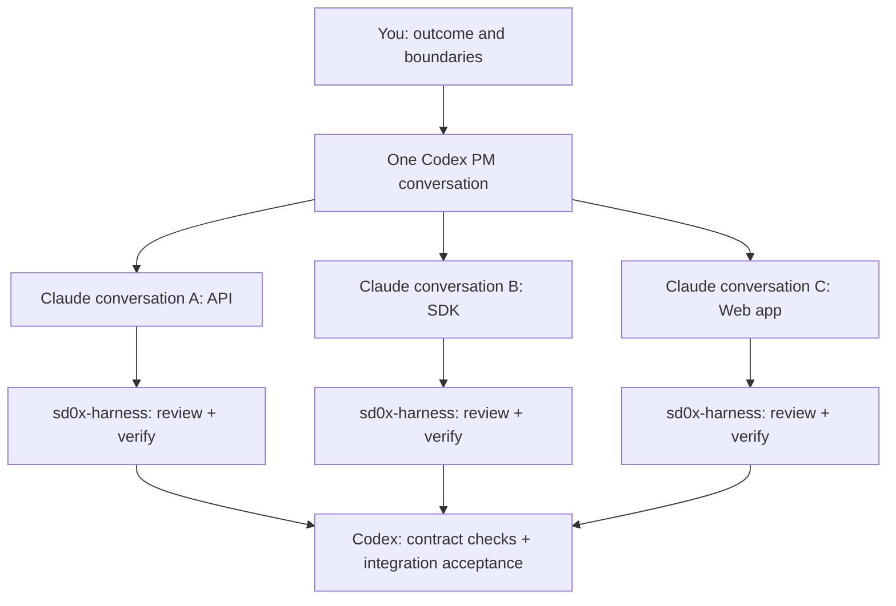

# Codex Dev Team

**One Codex conversation manages a development team of Claude Code conversations.**

English | [繁體中文](README.zh-TW.md)

Codex handles scope, architecture, dependencies, and integration acceptance. Claude Code handles implementation, tests, and review/verification through the **required [sd0x-harness](https://github.com/sd0xdev/sd0x-harness) Claude Code plugin**.

Start with one Claude conversation for a focused task. Add more when the work spans **related features or components that need joint integration**—for example, a web app, API service, and shared SDK across three repositories. Keep unrelated work in separate Codex conversations.



This is a **Codex skill**, with Python helpers for individual Claude runs. Codex coordinates the conversations; there is no hidden fleet scheduler or automatic cross-session chat. Harness reviewer conversations are separate from the PM conversation.

## Install

Requirements: Codex with skills support, Python 3.9+, Git, tmux, and an authenticated Claude Code CLI on macOS or Linux. The harness has its own runtime/reviewer requirements; follow its [current setup guide](https://github.com/sd0xdev/sd0x-harness#quick-start), including Node and jq. Choose an available model for your account. There is no hard-coded model or subscription policy.

In Codex, you can ask the built-in installer:

```text
Use $skill-installer to install the skill at
https://github.com/sd0xdev/codex-dev-team/tree/v0.1.0/skills/codex-dev-team
```

Or install a versioned checkout yourself:

```bash
git clone --branch v0.1.0 --depth 1 https://github.com/sd0xdev/codex-dev-team.git
cd codex-dev-team
python3 install.py
```

The included installer copies only `codex-dev-team` into `~/.agents/skills`. Use `--target /path/to/skills` for another Codex skills root, including a custom `$CODEX_HOME/skills`. It does not install Claude, sign you in, modify Codex settings, or install the harness into arbitrary projects. Start a new Codex session if the skill is not yet listed.

```bash
python3 install.py --dry-run
python3 install.py --target /path/to/skills
```

An identical installation is a no-op. A differing copy is refused unless you pass `--update`; updates back up the entire old directory beside the skills root under `.codex-dev-team-backups` and print its location. Other skills are untouched. Avoid installing duplicates into multiple roots.

## Required Claude Code plugin

**sd0x-harness is mandatory in every target project.** A skills-only `npx skills add` installation is insufficient for the Claude side of this workflow.

From each target repository, use the current Claude CLI's supported project/local scope:

```bash
claude plugin marketplace add sd0xdev/sd0x-harness
claude plugin install sd0x-dev-flow@sd0xdev-marketplace --scope project
```

Start a new Claude Code process, then run the full `/project-setup` inside Claude. After setup finishes, restart again and verify that the project's rules, hooks, runners, and settings are effective. Do not use `--lite`, `--no-rules`, or `--no-hooks`. Existing setups are checked and repaired using the installed plugin's instructions while preserving customization.

You can let Codex coordinate this as a setup-only task. Product work starts only after readiness is verified. Missing auth, dependencies, effective rules/hooks, or reviewer readiness produces `setup blocked`; the skill does not silently switch to development without the harness. See [the bundled readiness procedure](skills/codex-dev-team/references/harness.md).

## Use it

In a Codex conversation with access to your project:

```text
Use $codex-dev-team to implement pagination in this API.
Agree the acceptance criteria, verify sd0x-harness readiness, and delegate
implementation to Claude Code. Use my selected model and permission mode.
Review the final handoff and evidence. Do not push or deploy.
```

Codex records a mission, verifies prerequisites, and starts an owned tmux/Remote Control session. It checks the actual session and model before dispatching. Claude implements and completes its harness loop. Codex then checks the final diff, gate evidence, and acceptance criteria. RC can remain available for you to inspect the conversation. If you explicitly choose non-RC execution, the helper supports recorded print-mode runs.

## Scenarios and examples

These are example workflows, not claims of benchmark results or completed customer projects.

### 1. A focused feature in one repository

**Task:** add cursor pagination without breaking existing API consumers.

One Codex PM defines compatibility, ordering, and boundary cases. One Claude conversation changes the API and tests, completes the harness review/verify loop, and hands back evidence. Codex checks the acceptance criteria and sends a bounded revision if needed. More conversations are unnecessary when one owner can finish the work coherently.

### 2. Three projects that must work together: web + API + SDK

**Task:** introduce a searchable activity page backed by a new API and a shared client SDK.

```text
Use $codex-dev-team to coordinate these related repositories:
- /workspace/activity-api: endpoints, pagination, and API tests
- /workspace/client-sdk: typed client and contract tests
- /workspace/web-app: activity page, loading/error/empty states

Keep one Codex PM conversation and use one Claude conversation per repository.
First agree the shared API contract and verify sd0x-harness in every project.
Parallelize independent work after the contract is stable. Track exact component
revisions, then verify the real web → SDK → API path in a local test environment.
No publishing, push, or deployment is authorized by this request.
```

| Conversation | Owns | Handoff to integration |
|---|---|---|
| Claude API | API repo, schema, endpoint behavior | Contract revision, local endpoint, tests, harness evidence |
| Claude SDK | SDK repo, request/response types, client errors | Exact SDK revision, compatibility tests, harness evidence |
| Claude Web | Web repo, UI and user-visible states | Exact app revision, UI tests, harness evidence |
| Codex PM | Shared decisions, dependencies, acceptance | Verified component versions and end-to-end result |

An API contract change goes through Codex and is relayed to affected conversations. Consumers may use clearly labeled fixtures while waiting, but fixtures do not prove real integration. Once component owners stop editing, the designated integration owner wires the exact revisions together. Codex verifies required success and failure paths. Three green unit-test suites alone do not mean the feature is integrated.

### 3. Related services and a compatibility rollout

**Task:** change an event schema used by a producer and two consumers.

Codex fixes the compatibility contract and rollout order. Separate Claude conversations own producer, consumer A, and consumer B. They test old/new payload compatibility in their respective harness loops. Codex verifies the full event path and records which rollout stages are validated. Deployment remains a separate, explicitly scoped action.

### 4. Related modules in one monorepo

**Task:** update checkout UI and its payment adapter together.

Use separate Claude conversations only with disjoint file ownership, or isolated worktrees and one integration owner. Shared generated types, lockfiles, and Git operations must have a single owner. If that separation costs more than it saves, use one Claude conversation and execute sequentially.

## What the skill keeps track of

- Each conversation's repo, owned files, run directory, Claude session ID, tmux socket/pane, model, and authorization.
- Harness readiness per target project and original review/verify evidence after final edits.
- Shared contract revisions, dependencies, blockers, and component handoffs.
- Separate outcomes for local tests, review, verification, CI, deployment, runtime readback, and integration acceptance.

The runner refuses permission bypass, does not reuse run directories, and prevents blind initial mission replay. The watcher is read-only, deduplicates stop events, and preserves unsent prompt text. A stopped event, exit code, or “done” message is never acceptance by itself.

## Updates and removal

Public releases are curated by the maintainer; there is no automatic synchronization or fixed lag. To switch this versioned checkout to a newer published release:

```bash
git fetch origin tag vX.Y.Z
git switch --detach vX.Y.Z
python3 install.py --update
```

Replace `vX.Y.Z` with an actual release. Inspect the printed backup path before removing it. To uninstall, remove only the `codex-dev-team` directory from the skills root you selected; this does not remove project harness installations or runtime artifacts.

## Limits and validation

The helpers are tested offline with synthetic Claude/tmux fixtures. Terminal-state detection is heuristic; unsupported UI formats may require manual inspection. Authentication, account model availability, RC connectivity, paid execution, and actual multi-project delivery must be verified in your environment. More concurrent sessions can cost more; the skill imposes no private quota policy and makes no automatic speedup guarantee.

Run the tests without contacting a model:

```bash
python3 -m unittest discover -s skills/codex-dev-team/scripts -p 'test_*.py'
python3 -m unittest discover -s tests -p 'test_*.py'
```

See [release procedure](docs/RELEASING.md) and [changelog](CHANGELOG.md). Runtime artifacts can contain project data and should stay outside this repo.

## License

[MPL-2.0](LICENSE). When distributing modified covered files, their source remains available under MPL-2.0; separate files in a larger work can use other licenses. See [Mozilla's FAQ](https://www.mozilla.org/en-US/MPL/2.0/FAQ/). The sd0x-harness dependency is distributed separately under its own license. This community project is not an official OpenAI or Anthropic product.
