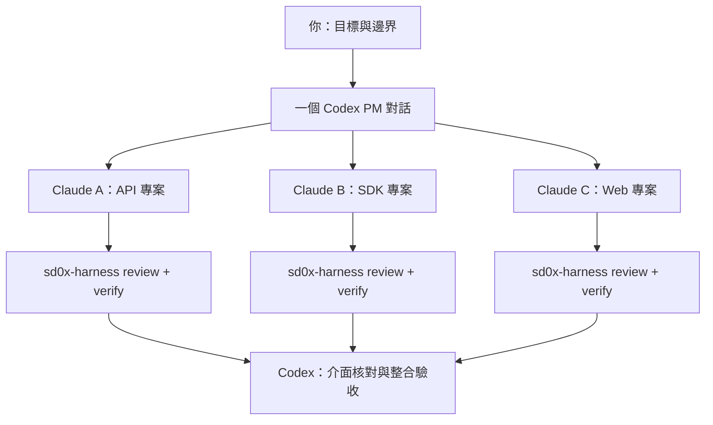

# Codex Dev Team

**用一個 Codex 對話，管理由多個 Claude Code 對話組成的開發團隊。**

[English](README.md) | 繁體中文

完整介紹：[Codex Dev Team：讓一個 Codex，帶一組 Claude 完成同一件事](https://blog.sd0x.dev/blog/codex-dev-team/) — 了解工作方式、適用對象與實際使用場景。

Codex 負責需求、架構、任務拆分、依賴協調與整合驗收；Claude Code 負責實作、測試，以及透過必要的 **[sd0x-harness Claude Code plugin](https://github.com/sd0xdev/sd0x-harness)** 完成獨立 review 與 verify。

簡單任務先用一個 Claude 對話。當工作涉及**相關功能、需要聯調的元件，或多個專案的串接**時，再由同一個 Codex PM 管理多個 Claude 對話。不相關的工作建議分開 Codex 對話，避免需求與決策混在一起。



這是安裝給 **Codex** 的 skill，內附管理個別 Claude run 的 Python 工具。多對話的分工與協調由 Codex 執行，沒有隱藏的自動排程服務。Harness 自己啟動的獨立 reviewer 對話，與上層 Codex PM 對話是不同角色。

## 安裝

需要支援 skills 的 Codex、Python 3.9+、Git、tmux、已登入的 Claude Code，以及 macOS 或 Linux。Harness 的 Node、jq 與 reviewer 等需求，請依[上游安裝文件](https://github.com/sd0xdev/sd0x-harness#quick-start)確認。模型由使用者選擇，不綁定特定模型或訂閱方案。

在 Codex 輸入：

```text
用 $skill-installer 安裝這個 skill：
https://github.com/sd0xdev/codex-dev-team/tree/v0.1.0/skills/codex-dev-team
```

或自行安裝指定版本：

```bash
git clone --branch v0.1.0 --depth 1 https://github.com/sd0xdev/codex-dev-team.git
cd codex-dev-team
python3 install.py
```

內附安裝器預設複製到 `~/.agents/skills/codex-dev-team`。可用 `--target /path/to/skills` 選其他 Codex skills root，例如自訂的 `$CODEX_HOME/skills`。若尚未出現在清單，請開新的 Codex session。

```bash
python3 install.py --dry-run
python3 install.py --target /path/to/skills
```

相同版本不重複寫入；內容不同時預設拒絕覆蓋。指定 `--update` 才會先備份舊目錄，再換成新版本，並列出備份位置。備份位於 skills root 旁的 `.codex-dev-team-backups`。安裝器不修改其他 skills、CLI 登入或全域設定，也不會自動對任意專案安裝 harness。避免在多個 roots 重複安裝。

## 必要依賴：sd0x-harness

**每個目標專案都必須使用完整的 sd0x-harness Claude Code plugin。** Codex 端 `npx skills add` 的 skills-only 安裝不能取代它。

在各目標 repo 依當前 CLI 支援的 scope 安裝：

```bash
claude plugin marketplace add sd0xdev/sd0x-harness
claude plugin install sd0x-dev-flow@sd0xdev-marketplace --scope project
```

重新啟動 Claude Code，在 Claude 對話內執行完整 `/project-setup`；設定完成後再次重啟，確認該 repo 的 rules、hooks、runners 與 settings 已載入生效。不能使用 `--lite`、`--no-rules` 或 `--no-hooks`。既有專案依安裝版本的流程更新與修復，保留自訂設定。

可以讓 Codex 先安排 setup-only 任務。只有 readiness 確認為 `ready` 才能開發；缺登入、依賴、有效 hooks／rules 或 reviewer 時，回報 `setup blocked` 與具體缺口，不退回無 harness 開發。完整程序已包在 [harness.md](skills/codex-dev-team/references/harness.md)，不需取得其他私人 skill。

## 使用方式

```text
用 $codex-dev-team 幫這個 API 加上分頁。
先確認驗收條件與 sd0x-harness readiness，再委派 Claude Code 實作。
使用我指定的模型與 permission mode，最後核對 handoff 與原始驗證證據。
這次不 push、不部署。
```

Codex 建立任務包、確認依賴、開啟獨立的 tmux／Remote Control 對話，核對實際 session、模型與 idle 狀態後才送出任務。Claude 完成實作與 harness loop，再由 Codex 核對 diff、證據與 AC。使用者可透過 RC 查看對話；明確選擇不使用 RC 時，也支援保存執行紀錄的 print mode。

## 使用場景與案例

以下是使用範例，不是效能測試或已完成的客戶案例。

### 1. 單一專案的一個完整功能

**需求：API 新增 cursor 分頁，保留既有相容性。**

Codex 定義排序、分頁邊界、相容性與驗收方式。一個 Claude 對話負責 API、測試與 harness review／verify，完成後交回證據。Codex 驗收或發出範圍明確的修訂任務。可以由一個 owner 完成的工作，不必為了多對話而拆分。

### 2. 三個專案串接：Web + API + SDK

**需求：新增可搜尋的活動紀錄頁，同時修改後端 API 與共用 client SDK。**

```text
用 $codex-dev-team 協調以下相關專案：
- /workspace/activity-api：endpoint、分頁、API 測試
- /workspace/client-sdk：型別、client、contract tests
- /workspace/web-app：活動頁、載入／錯誤／空資料狀態

用一個 Codex PM 對話管理，每個 repo 各開一個 Claude 對話。
先確定共同 API 契約，並逐專案確認 sd0x-harness readiness。
介面穩定後再平行開發，記錄各元件的確切 revision，
最後在本機測試環境驗證真正的 Web → SDK → API 串接。
本次沒有授權發布、push 或部署。
```

| 對話 | 負責範圍 | 交給整合階段的內容 |
|---|---|---|
| Claude API | API repo、schema、endpoint 行為 | 契約版本、本機服務、測試與 harness 證據 |
| Claude SDK | SDK repo、request／response 型別、錯誤處理 | SDK revision、相容性測試與 harness 證據 |
| Claude Web | Web repo、UI 與使用者可見狀態 | App revision、UI 測試與 harness 證據 |
| Codex PM | 共同決策、依賴順序與驗收 | 確認過的元件版本及端到端結果 |

API 契約變更先回到 Codex，再通知受影響的 Claude 對話。等待上游時可以用有標示的 fixture，但 fixture 不代表真實串接成功。各 owner 停止編輯後，由指定的整合 owner 組合確切版本，Codex 核對成功與必要的錯誤路徑。三個專案各自測試通過，仍不能直接宣告聯調完成。

### 3. 多服務的相容性變更

**需求：修改事件格式，同時涉及 producer 與兩個 consumer。**

Codex 先固定相容性契約與 rollout 順序，再分別讓三個 Claude 對話負責各服務。每個服務完成新舊 payload 的相容性測試與 harness loop，Codex 核對完整事件流以及各階段的驗證範圍。部署依本次明確授權另行處理。

### 4. Monorepo 中需要配合的模組

**需求：同時更新結帳 UI 與付款 adapter。**

只有檔案責任明確分離，或採用隔離 worktree 並指定整合 owner 時，才讓多個 Claude 同時改動。共用型別、lockfile、Git 操作都要有單一 owner。若拆分成本高於收益，就用一個 Claude 對話循序完成。

## 協作時保留的資訊

- 每個對話的 repo、檔案責任、run 目錄、Claude session ID、tmux socket／pane、模型與授權。
- 每個專案的 harness readiness，以及最後編輯後的原始 review／verify 證據。
- 共同契約版本、依賴、阻擋與各元件 handoff。
- 分開記錄 local tests、review、verify、CI、部署、runtime readback 與整合驗收。

Runner 拒絕 bypass permissions、不重用 run 目錄，並防止初始任務在送出失敗後被盲目重送。Watcher 只讀取狀態、去重停止事件，不代按允許，也不清空未送出的草稿。停止事件、exit 0 或一句「完成」，都不會自動等於驗收通過。

## 更新與移除

公開版由維護者自行安排發布時間，不自動同步其他 repo，也沒有固定落後版本數。更新到已發布的新版本：

```bash
git fetch origin tag vX.Y.Z
git switch --detach vX.Y.Z
python3 install.py --update
```

將 `vX.Y.Z` 換成實際 release。確認安裝器印出的備份位置後，再決定是否刪除備份。移除時只刪所選 skills root 下的 `codex-dev-team`；專案中的 harness 與執行紀錄不會跟著被刪除。

## 驗證與限制

工具使用合成的 Claude／tmux fixtures 做離線測試；終端狀態偵測是啟發式，UI 格式不支援時可能需要人工核對。登入、帳號可用模型、RC 連線、付費模型執行與真實跨專案整合，仍須在實際環境確認。更多平行對話可能增加成本，不保證一定更快，也不套用私人額度政策。

```bash
python3 -m unittest discover -s skills/codex-dev-team/scripts -p 'test_*.py'
python3 -m unittest discover -s tests -p 'test_*.py'
```

另見[發布流程](docs/RELEASING.md)及[版本紀錄](CHANGELOG.md)。執行紀錄可能含專案資料，應保存在此 repo 外。

## 授權

[MPL-2.0](LICENSE)：對外散布修改過的受授權檔案時，這些檔案的原始碼仍須依 MPL-2.0 提供；組合成較大作品時，其他獨立檔案可採不同授權。詳見 [Mozilla 官方 FAQ](https://www.mozilla.org/en-US/MPL/2.0/FAQ/)。sd0x-harness 以其自己的授權另外散布。本專案不是 OpenAI 或 Anthropic 的官方產品。
