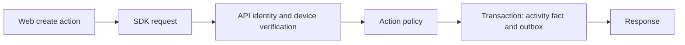
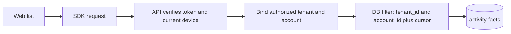
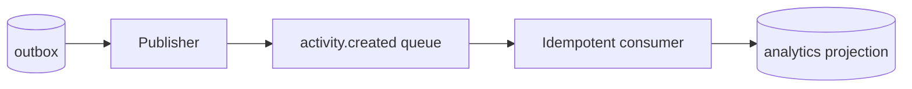

<!-- SPDX-License-Identifier: MPL-2.0 -->
# Worked example: an activity page across Web, SDK and API

**Synthetic document walkthrough, not a live implementation or E2E result.** All paths, hashes, session IDs, reports and outcomes below are invented fixtures. They contain no account details or credentials. In real work, replace them with observed facts; do not copy the example topology or data visibility policy into a project.

## Request and canonical records

Build an activity page for an account within its tenant. This example's agreed policy allows a valid device of that account to list the account's activity from all its devices. Another account or tenant must not be visible. This is an explicit scenario requirement, not a default policy of the skill.

- AC-1: Web loads a page through the real SDK and API; pagination does not skip or duplicate an item at the agreed cursor boundary.
- AC-2: device A can see activity attributed to device B of the same account; reject an invalid device/session and prevent cross-account/tenant reads.
- AC-3: an invalid cursor produces the agreed error, handled by SDK and Web.
- AC-4: creating an activity item writes a durable fact and eventually updates analytics without duplicate counting on redelivery.
- Non-goals: deployment/production rollout, changing visibility policy, unrelated features.

The API owner maintains the existing `activity-api/docs/activity.md` and `contracts/activity.yaml`; SDK and Web link to them at their adopted API revision. Each repo keeps a short `docs/activity-handover.md` recording design decisions and remaining product work, without machine/run details. The PM keeps `/work/coord/activity/ledger.md`, input missions and integration evidence outside `/work/repos/`. Helper-owned runs live separately in `/work/runs/activity/`, with the short owned socket `/tmp/act.sock`.

### Canonical responsibility table excerpt

These are **scenario assumptions expressed as code-inspection fixtures**, not inspected production behavior. An actual owner would resolve every symbol below at the recorded revision and correct the map if the code disagrees.

| Data / contract | Owner / repo | Authority / derived copies | Keys and semantics | Write/update | Actual query source / readers | Code fixture |
|---|---|---|---|---|---|---|
| Activity facts | API / activity-api | `activity` DB table; authoritative raw facts | `tenant_id` + `account_id`: ownership/filter; `activity_id`: fact identity; `device_id`: originating-device attribution | POST after account/device eligibility and action policy | GET reads `activity`; SDK relays results to Web | `routes/create`, `routes/list`, `activityRepository` |
| Account/device registry | API / activity-api | identity DB; authoritative eligibility | tenant/account binding; device/session eligibility | enrollment/revocation outside this feature | auth middleware; not the activity-list store | `authorizeDevice` |
| Activity contract | API / activity-api | `contracts/activity.yaml`; SDK types derived | cursor and response field meanings | reviewed contract change adopted per owner | SDK client + Web renderer | `activity.yaml`, SDK `activityClient`, Web `ActivityPage` |
| Analytics counts | API / activity-api (consumer owner) | derived projection; event redelivery deduped by `event_id` | `activity_id`: relation to fact; `event_id`: dedupe; tenant/account: grouping | outbox → queue → consumer | analytics only; activity GET does **not** read this projection | `outboxPublisher`, `activityConsumer` |

### Three separate flows in that same document

The durable transaction precedes the asynchronous publication side effect. Queue failure delays the projection; it does not move list reads to analytics. No other external side effect is assumed. If actual code has another owner, entrypoint or transaction boundary, update this map rather than reorganizing the code to resemble it.

| Layer | Example trace to verify in actual code |
|---|---|
| Access eligibility | middleware verifies token/account/tenant and binds the current device/session to that account; rejects invalid/revoked device |
| Query scope | authenticated `tenant_id` and `account_id` become repository filter parameters; no current-device filter in this scenario; caller-supplied account cannot override authorized subject |
| Transport credentials | `Authorization` header carries a token; `X-Device-ID` identifies the device and must be verified; signed `sub` / `tenant` claims and verified device are passed as auth context; no token values are recorded |
| Logging / attribution | `request_id` traces the call; stored `device_id` attributes creation; neither is a list filter; ownership keys above are filters |

If actual `activityRepository` filters by device, record the discrepancy and ask the policy owner whether docs or behavior should change. Do not remove that filter just because this worked example is account-scoped.

## Filled external ledger checkpoint (scenario state S1)

PM: `pm-owner`. Integration verification owner: `api-owner` using the isolated integration workspace; other owners are not authorized to write it. Goal/AC and canonical docs link to the sections above. Target contract: `activity-v1` in API revision A1. Last reconciled: `2026-11-16T09:00:00Z`. Shared acceptance: **open**, I-01 scheduled.

Exact synthetic clean commits (full IDs for this example):

| Label | Repo | Commit |
|---|---|---|
| A1 | activity-api | `1111111111111111111111111111111111111111` |
| S1 | client-sdk | `2222222222222222222222222222222222222222` |
| W1 | web-app | `3333333333333333333333333333333333333333` |
| A2 | activity-api | `4444444444444444444444444444444444444444` |
| S2 | client-sdk | `5555555555555555555555555555555555555555` |
| W2 | web-app | `6666666666666666666666666666666666666666` |

Labels below resolve to these IDs, never to floating branches. All proposed fixtures are clean; a real dirty handoff instead needs a content digest plus retained patch/snapshot as required by the integration template.

| Owner | Repo/worktree | Writable scope / exclusions | Dependency / adopted contract | Current run / metadata | Latest handoff / code | Deployment | Blocker / next step |
|---|---|---|---|---|---|---|---|
| api-owner | `/work/repos/activity-api` | `src/`, `tests/`, `contracts/`, `docs/`; no other repo | shared schema / v1 | `/work/runs/activity/api-01/meta.json` | `/work/coord/activity/handoffs/api-01.md` / A1 | N/A: local only | stopped editing; integrate I-01 |
| sdk-owner | `/work/repos/client-sdk` | `src/`, `tests/`, `docs/`; no API schema writes | API v1 / v1 | `/work/runs/activity/sdk-01/meta.json` | `/work/coord/activity/handoffs/sdk-01.md` / S1 | N/A | stopped editing; await I-01 |
| web-owner | `/work/repos/web-app` | `src/`, `tests/`, `docs/`; no SDK writes | SDK v1 / v1 | `/work/runs/activity/web-01/meta.json` | `/work/coord/activity/handoffs/web-01.md` / W1 | N/A | stopped editing; await I-01 |

Run readback snapshots at the checkpoint (all synthetic):

| Owner | Claude session ID | Socket / pane | Effective readiness and original evidence | Model / permission / authorization | Process and RC |
|---|---|---|---|---|---|
| api-owner | `00000000-0000-4000-8000-000000000001` | `/tmp/act.sock` / `%1` | ready; selected installed harness version H, project scope; `evidence/api-readiness.md` | user-selected full ID M; effort per recorded choice; supported mode P; `authorizations.md#local-work` | idle, no draft/background writer; RC observed active at checkpoint |
| sdk-owner | `00000000-0000-4000-8000-000000000002` | `/tmp/act.sock` / `%2` | ready; H, project scope; `evidence/sdk-readiness.md` | M / P / same authorization | exited after handoff; RC not active |
| web-owner | `00000000-0000-4000-8000-000000000003` | `/tmp/act.sock` / `%3` | ready; H, project scope; `evidence/web-readiness.md` | M / P / same authorization | idle at checkpoint; RC readback required before next send |

H, M and P represent recorded installed/user-selected values, **not executable defaults**. The readiness reports include loaded rules/hooks/runners and restart readback; the authorization permits local edits/tests and local commits only, no push or deployment. Actual tasks must record the exact choices. All relative evidence paths here are under `/work/coord/activity/`.

### One bounded mission and its handoff

SDK mission `missions/sdk-01.md` links the ledger's sdk-owner row and AC-1/AC-3. Implement the v1 cursor and response contract pinned at A1; own only SDK paths above, preserve public compatibility agreed for v1, update the SDK's durable note and complete its installed harness review/verify. Use API fixtures for development while waiting, explicitly label them. API owns canonical docs; request changes through PM. Return a stopped-editing handoff; do not call SDK fixture success shared acceptance.

SDK handoff `handoffs/sdk-01.md` records the exact sdk-01 identity, clean S1, adopted v1, changed client/tests/note, and links original `evidence/sdk-01/review.md` + `verify.txt` bound to S1. In this fictional state the component checks pass, but AC-1/AC-3 remain pending real integration in I-01. Its next action is wait for the integration owner. API and Web handoffs use the same template for their own scope and evidence.

## I-01: fixed-contract integration exercise

This is a **filled synthetic integration record**, not an executed test report. Owner: api-owner; time `2026-11-16T09:20:00Z`. Inputs A1/S1/W1, all clean; contract `activity-v1`; canonical map at A1; local environment config `integration-env-v1`. Deployment/image: not applicable, local services launched from the recorded checkouts; no production claim.

| AC/case | Planned actual path / scenario | Simulated outcome in this document | Original evidence pointer in the hypothetical run |
|---|---|---|---|
| AC-1 | browser → built SDK → local API → facts DB; page twice across boundary | pass | `evidence/I-01/pagination.txt` |
| AC-2a | device A of account X sees fact from device B of X | pass | `evidence/I-01/scope.txt` |
| AC-2b | invalid device, foreign account/tenant subject or override attempt | denied as required | `evidence/I-01/denials.txt` |
| AC-3 | malformed cursor travels through real client and API error handling | pass | `evidence/I-01/cursor-error.txt` |
| AC-4 | POST commits fact/outbox; actual local queue redelivery updates projection once | pass | `evidence/I-01/async.txt` |

The hypothetical record also links each team's final code/doc review and verify reports; fixture tests are separate. PM could accept **only this local combination** if those original reports and observations really existed. Here they do not: runtime evidence is **not run**, so the walkthrough itself grants no product acceptance.

## CH-01: contract changes while teams have other work

API proposes v1 → v2: rename response `next_cursor` to `nextCursor` and adjust malformed-cursor error shape. PM records the exact schema diff at A2, sets the approved target to v2, and identifies SDK decoding and Web pagination/error UI as affected. Auth scope, writes and async payload are unchanged by the scenario's diff.

In ledger `changes/CH-01`, keep I-01's outcomes and A1/S1/W1 intact as historical. Mark its AC-1 and AC-3 evidence **needs revalidation for v2**; do not relabel it as a failed v1 test. AC-2/AC-4 evidence is reusable only with documented impact analysis of unchanged auth/query/write/consumer paths and environment, linked from the new record. If that analysis is uncertain, rerun the relevant path.

| Owner | Safe delivery / adoption progression | Required repair / follow-up |
|---|---|---|
| api-owner | proposal acknowledged at A2, v2 adopted | canonical schema/map/note reviewed at A2; return new handoff |
| sdk-owner | queue `missions/CH-01-sdk.md`; verify old process stopped; resume from sdk-01 into sdk-02 with **same session ID**; fresh RC/model/idle readback; dispatch new mission once; then delivered; acknowledgment/handoff records adoption | decode both changed fields/semantics, run affected tests and required final-edit gates, return S2/v2 |
| web-owner | currently busy on non-overlapping UI work; mark queued only and let safe work continue; after actual idle/no draft/background-work inspection, deliver bounded revision in the recorded conversation; record acknowledgment separately | update pagination/error UI and note, review/verify, return W2/v2 |

No all-team stop, guessed session, automatic injection, permission expansion or replay of initial dispatch. Per-team adopted contract remains v1 until acknowledged adoption; queued notifications do not change that field.

I-02 freezes A2/S2/W2 + v2 + canonical docs at A2 + the unchanged local config. Run AC-1 and AC-3 on this combination, retain I-01 AC-2/AC-4 references with the reviewed no-impact rationale, and record exactly which paths were rerun versus reused. If runtime inputs or authorization logic also changed, widen the relevant verification scope. PM closes only after current evidence covers all AC, docs and gates cover final edits, and no affected adoption/revalidation remains open. I-02 is still hypothetical here, not a claimed E2E pass.

## Recovery exercise: compaction during CH-01

Persist this checkpoint in the external ledger: target v2; api-owner at A2/v2; SDK has sdk-02 metadata, same recorded session ID as sdk-01, S2/v2 handoff; Web remains W1/v1, CH-01 update **queued**, no W2 handoff; I-01 historical, AC-1/AC-3 need revalidation; I-02 pending. Last checked `2026-11-16T10:00:00Z`. Next owner: web-owner, safe delivery then repair; integration owner waits for W2 before I-02.

A fresh PM reads those records, checks sdk-02's original metadata rather than treating sdk-01 as current, reconciles repository revisions and setup state, and inspects the owned Web pane. If it contains a user draft, leave it untouched and keep the update queued. If the process exited, follow recorded resume; if identity/readiness cannot be established, record the gap before dispatch. Do not infer present RC connectivity from the morning's snapshot. After Web's new handoff, update the ledger and let the integration owner capture the real tested combination.

## Small-task counterexample

For one repo's typo fix with no shared data/contract/service dependency, use the ordinary mission and handoff, respecting that repo's review/verify requirements. Omit their shared-team sections; do not create a team ledger, three flow diagrams or an integration record. An unrelated team's work stays in its own PM context.
